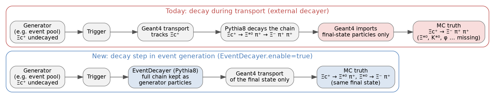

# Decays before transport

Particles that leave the generator undecayed, for example charm baryons from an event pool or particles left by an external generator, are by default decayed during the Geant4 transport. Geant4 either uses its own decay tables or hands the particle to Pythia8 as the VMC external decayer (`DecayerPythia8`).

In the second case Geant4 takes over only the final-state particles of the decay chain. The final state and its kinematics are correct, but every intermediate state that Pythia8 decays inside the call is missing from the MC truth. For example, Ξc⁺ → Ξ(1530)⁰ π⁺ with Ξ(1530)⁰ → Ξ⁻ π⁺ is recorded as a three-body decay Ξc⁺ → Ξ⁻ π⁺ π⁺, and Ξc⁺ → p K̄*⁰ or Ξc⁺ → p φ appear as p K π and p K K. Resonant and non-resonant contributions can then not be told apart in the MC truth. Charm and beauty hadrons that reach Geant4 without the external decayer are decayed with simple placeholder decays.

The `EventDecayer` decays such particles with Pythia8 as a step of the event generation, after the trigger and before the transport. The full decay chain enters the kinematics as generator particles, and Geant4 only transports the final state.



## Usage

The step is available in AliceO2 from [PR 15995](https://github.com/AliceO2Group/AliceO2/pull/15995) on. It is off by default and is switched on with `EventDecayer.enable=true`. It then runs for every generator, including the replay of event pools and of Kine files:

```bash
# event pool with undecayed signals, decayed with a request-specific Pythia8 config
o2-sim -g evtpool --configKeyValues "GeneratorEventPool.eventPoolPath=pool.root;EventDecayer.enable=true;EventDecayer.config[1]=my_decays.cfg"

# decay the particles of an existing Kine file, without transport
o2-sim --noGeant -g extkinO2 --extKinFile in_Kine.root -o decayed --configKeyValues "EventDecayer.enable=true;EventDecayer.config[1]=my_decays.cfg"
```

Particles that were already decayed by the generator, or that are not flagged for transport, are left untouched, so running the step twice changes nothing. In O2DPG workflows the step belongs in the event-generation task (`sgngen`). When creating event pools it should stay off, so that the pools can still be decayed differently by each production that uses them.

## Configuration

| Key | Default | Meaning |
|---|---|---|
| `EventDecayer.enable` | `false` | run the step in event generation |
| `EventDecayer.config[0..7]` | empty | Pythia8 decay configs; an empty slot takes `DecayerPythia8.config` of the same slot, so both decayers read `base.cfg` and any request config by default |
| `EventDecayer.tau0Max` | `10` | species with a larger `tau0` (mm/c) are never decayed and are left to Geant4; `<= 0` disables the cut |
| `EventDecayer.skipPdg` | see below | PDG codes never decayed by the step |
| `EventDecayer.seed` | `0` | Pythia8 seed; `0` takes it from the o2-sim seed |
| `EventDecayer.g4ParticleTable` | empty | optional Geant4 particle table, written by `o2-sim-g4-particle-table`, to report particles unknown to Geant4 |
| `EventDecayer.verbose`, `showChanged` | `false` | Pythia8 printout |

## Which particles are decayed

The step decays a particle only if it is flagged for transport, Pythia8 may decay it (`id:mayDecay = on`), its `tau0` is at most `EventDecayer.tau0Max`, and it is not listed in `EventDecayer.skipPdg`. Everything else reaches Geant4 unchanged. The channels are set in Pythia8's own terms (`id:onMode`, `id:oneChannel`, `id:addChannel`, ...), so a request's forced-decay config works for the step as it does for the external decayer.

Long-lived particles such as K0S, Λ, Σ±, Ξ and Ω are never decayed by the step, for two independent reasons. `base.cfg`, which is read first, sets `mayDecay off` for them, and the default `tau0Max` of 10 mm/c excludes them anyway (cτ is about 27 mm for K0S, 79 mm for Λ, 49 mm for Ξ⁻ and 24 mm for Ω⁻). They are therefore transported by Geant4 as before, with their hits, their bending in the field and their interactions with the material, which strangeness tracking and efficiency studies need. A request does not need to add `ParticleDecays:limitTau0` or `tau0Max` to its own config; a positive `EventDecayer.tau0Max` takes precedence over a `tau0Max` in a config file.

The same keys also allow decaying such particles in the generator, by setting `mayDecay on` and raising or disabling `tau0Max`. Do this only for generator-level studies without transport (`o2-sim --noGeant`). With transport it is wrong, because the step places the decay point on a straight line from the production vertex and knows nothing about the detector: the particle would leave no hits, would not bend or interact, and its daughters would become generator primaries, which changes their physical-primary classification.

`base.cfg` also keeps the weakly decaying charm baryons stable, because the external decayer receives them from Geant4 one at a time. A request that wants the step to decay them switches them on. For Ξc⁰, Ξc⁺ and Ωc⁰ the O2DPG file `MC/config/PWGHF/pythia8/decayer/eventdecayer_charmbaryon.cfg` ([O2DPG PR 2518](https://github.com/AliceO2Group/O2DPG/pull/2518)) does this, next to the usual forced channels:

```bash
--configKeyValues "DecayerPythia8.config[1]=${O2DPG_MC_CONFIG_ROOT}/MC/config/PWGHF/pythia8/decayer/force_hadronic_charmbaryon.cfg;EventDecayer.enable=true;EventDecayer.config[2]=${O2DPG_MC_CONFIG_ROOT}/MC/config/PWGHF/pythia8/decayer/eventdecayer_charmbaryon.cfg"
```

The default `skipPdg` holds the resonances for which O2 defines its own Geant4 decay modes (`115 225 335 10221 10331 20223 20333 102132 102134 9010221`, among them Λ(1520) and f0(980)). They are kept in the MC truth but decayed by Geant4. A request that wants Pythia8 to decay them overrides the list.

At the end of the run the step prints a summary: decayed and failed decays per species, PDG codes unknown to `O2DatabasePDG` (or to the Geant4 table, if given), and lifetimes that differ from Geant4 by more than 1%.

## Things to know

- Pythia8's vertex-limit settings `ParticleDecays:limitTau`, `limitRadius` and `limitCylinder` are refused; only the species-level `limitTau0`/`tau0Max` is supported.
- No parton is ever handed to the transport. A decay into partons (e.g. some quarkonium decays) is either hadronised by Pythia8 itself (recent Pythia8 versions) or, if partons remain, not performed, and the particle is left to Geant4 as before.
- To check in an AOD who decayed a particle, use the `producedByGenerator()` accessor of `McParticles`: products of the step are generator particles, while the daughters of particles decayed by Geant4 are not. Reading the raw `fFlags` column (e.g. with `RDataFrame`) can return it as a boolean and is not reliable for this.
- The decay products are primaries, so all their transport secondaries are stored. For an HF event pool this made the Kine files about 0.6% larger.
- The lifetimes of several charm and beauty hadrons in Pythia8's defaults are older measurements; `base.cfg` sets the PDG values for them.
